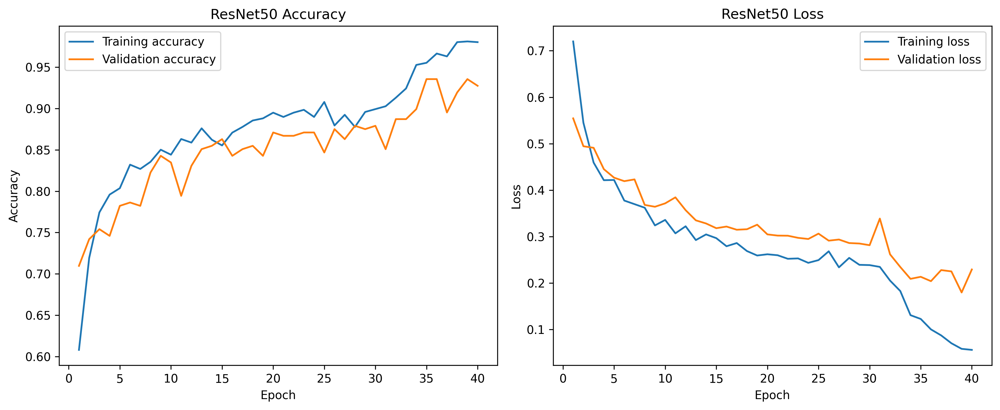
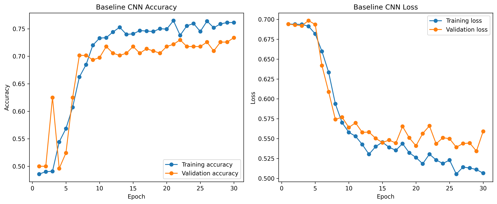
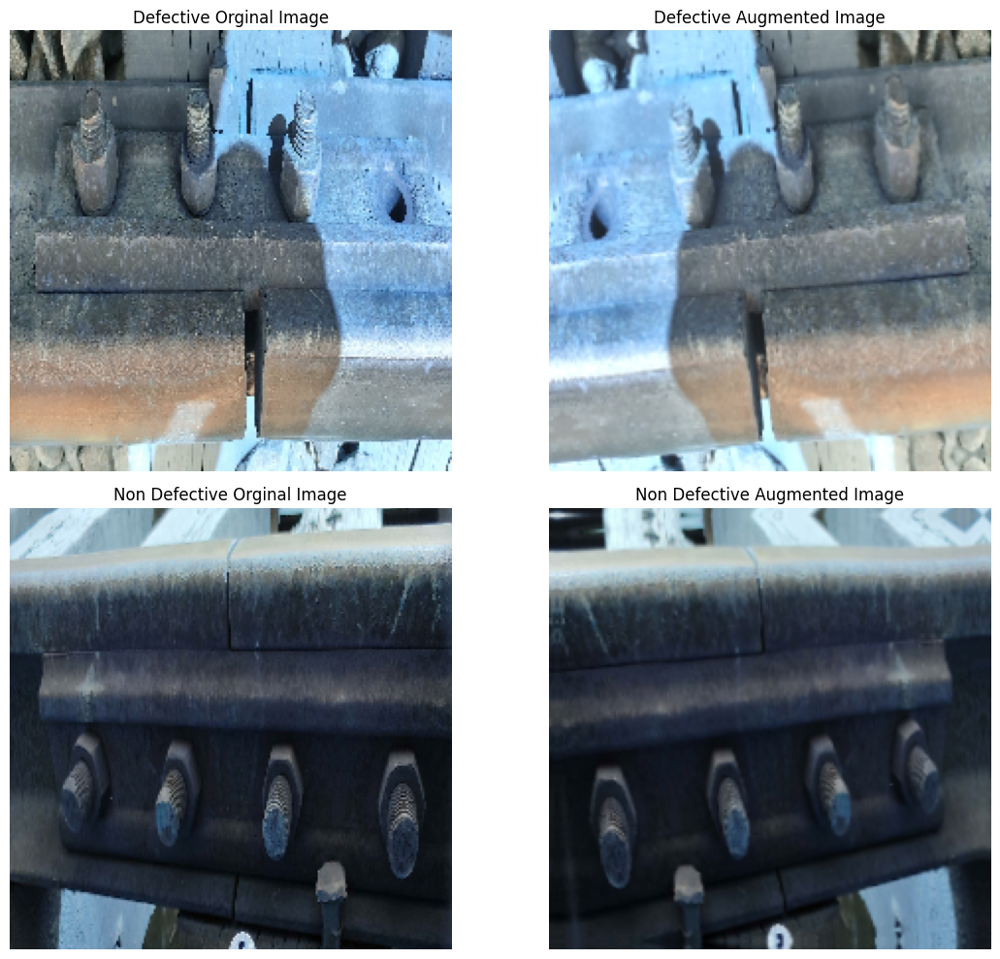

# Railway Track Defect Detection Using CNNs & Transfer Learning

[](https://www.python.org/)
[](https://www.tensorflow.org/)
[](https://keras.io/)
[](LICENSE)
[](docs/Railway_Track_Defect_Detection_Report.pdf)

> **Academic Project**  
> **Authors:** Sherbal Al Khouri & George Saba  
> **Institution:** School of Engineering, Jönköping University  
> **Full Paper:** [Railway Track Defect Detection Using Convolutional Neural Networks and Transfer Learning (PDF)](docs/Railway_Track_Defect_Detection_Report.pdf)

---

## 📌 Executive Summary

Railway track integrity is vital for modern transportation safety. Defective tracks, surface cracks, and broken fastening systems can cause catastrophic train derailments, resulting in severe human and economic losses. Traditional track inspection relies on manual foot patrols, which are slow, labor-intensive, costly, and susceptible to human error.

This project implements and evaluates an **automated computer vision pipeline for binary railway defect classification** (*Defective* vs. *Non-defective*). We investigate whether transfer learning can overcome the severe data scarcity typical in industrial railway inspection by benchmarking:
1. **Baseline CNN**: A custom 3-block convolutional neural network trained from scratch.
2. **Transfer Learning (ResNet50)**: A two-stage transfer learning model leveraging an ImageNet-pretrained ResNet50 backbone with progressive fine-tuning.

```
                              [ Railway Track Image (224x224) ]
                                              │
                      ┌───────────────────────┴───────────────────────┐
                      ▼                                               ▼
         [ Baseline CNN From Scratch ]                   [ Two-Stage ResNet50 Model ]
         - 3 Conv Blocks (32, 64, 128)                   - Stage 1: Frozen ImageNet Backbone
         - Global Average Pooling                        - Custom Head (GAP + Dropout + Dense)
         - Dense(64) + Dropout(0.3)                      - Stage 2: Fine-Tuning Top 30 Layers
                      │                                               │
                      ▼                                               ▼
           Test Accuracy: 77.0%                            Test Accuracy: 92.0%
           Defective Recall: 0.69                          Defective Recall: 0.89
           Missed Defects: 38 / 124                        Missed Defects: 14 / 124
```

---

## 🎯 Key Results & Comparison

All evaluations were conducted on an independent, held-out test set of 249 images (124 defective, 125 non-defective).

| Evaluation Metric | Baseline CNN (From Scratch) | Fine-Tuned ResNet50 | Impact / Improvement |
|:---|:---:|:---:|:---:|
| **Overall Test Accuracy** | 77.0% | **92.0%** | **+15.0%** |
| **Defective-Class Recall** | 0.69 | **0.89** | **+0.20 (+29.0%)** |
| **Missed Defects (False Negatives)** | 38 / 124 (30.6%) | **14 / 124 (11.3%)** | **-63.2% reduction** |
| **Defective Precision** | 0.81 | **0.96** | **+0.15 (+18.5%)** |
| **Defective F1-Score** | 0.75 | **0.92** | **+0.17 (+22.7%)** |
| **Non-defective Recall** | 0.84 | **0.96** | **+0.12** |
| **False Alarms (False Positives)** | 20 / 125 | **5 / 125** | **-75.0% reduction** |

### Confusion Matrices

```
        Baseline CNN (Test Set)                       Fine-Tuned ResNet50 (Test Set)
     Predicted:  Defective  Non-defective          Predicted:  Defective  Non-defective
Actual Defective    [ 86        38 ]            Actual Defective    [ 110       14 ]
Actual Non-def      [ 20       105 ]            Actual Non-def      [   5      120 ]
```

---

## ⚠️ Why Defective Recall Matters (Safety-Critical Domain)

In generic image classification, accuracy is commonly treated as the primary metric. However, in safety-critical railway infrastructure, **the cost of classification errors is heavily asymmetric**:

- **False Positive (Type I Error)**: A normal track is flagged as defective. Consequence: A maintenance crew performs a secondary manual verification. Operational cost is minimal.
- **False Negative (Type II Error)**: A defective track is classified as normal. Consequence: A damaged or fractured rail goes undetected under heavy freight/passenger traffic, risking **derailment, injury, and loss of life**.

Therefore, **Defective Recall** (the proportion of actual defects successfully caught) is the decisive evaluation criterion. Fine-tuning ResNet50 reduced missed defects from **38 down to 14**, making it viable as an automated decision-support system.

---

## 📈 Training Dynamics & Visualizations

### ResNet50 vs. Baseline Training Curves
Fine-tuning the last 30 layers of ResNet50 allowed the network to adapt high-level abstract representations to rail textures, achieving rapid convergence and superior generalization.


*Figure 1: Training and validation accuracy/loss for the two-stage ResNet50 model (Epochs 1–30: frozen backbone; Epochs 31–40: fine-tuning top 30 layers).*


*Figure 2: Training and validation accuracy/loss for the baseline CNN trained from scratch (30 epochs).*

### On-the-Fly Data Augmentation
To counteract overfitting on the limited dataset size, on-the-fly transformations (random horizontal flipping, +/-10% rotation, +/-10% zoom, and +/-10% brightness variations) were applied during training:


*Figure 3: Visual comparison of original vs. augmented samples for defective and non-defective track images.*

---

## 🔬 Dataset & Data Cleaning

The raw railway dataset contains real-world track images under varying lighting, camera angles, backgrounds, and weather conditions.

1. **Conflict Resolution**: During dataset auditing, 59 images were found to have contradictory labels (annotated as both *Defective* and *Non-defective* in different entries). All contradictory instances were pruned to prevent conflicting training gradients.
2. **Clean Dataset Partitioning**: The resulting 1,659 images were split into stratified, class-balanced sets with a fixed random seed (`1337`) for full reproducibility:

| Split | Defective | Non-Defective | Total Images | Ratio |
|---|:---:|:---:|:---:|:---:|
| **Training** | 581 | 580 | 1,161 | 70% |
| **Validation** | 125 | 124 | 249 | 15% |
| **Test (Held-out)** | 124 | 125 | 249 | 15% |
| **Total** | **830** | **829** | **1,659** | 100% |

---

## 🏗️ Architecture Details

### 1. Custom Baseline CNN (From Scratch)
- **Input**: `224 × 224 × 3` RGB images (rescaled to `[0, 1]`)
- **Block 1**: `Conv2D(32, 3x3, ReLU)` + `MaxPooling2D(2x2)`
- **Block 2**: `Conv2D(64, 3x3, ReLU)` + `MaxPooling2D(2x2)`
- **Block 3**: `Conv2D(128, 3x3, ReLU)` + `MaxPooling2D(2x2)`
- **Head**: `GlobalAveragePooling2D` + `Dense(64, ReLU)` + `Dropout(0.3)` + `Dense(1, Sigmoid)`
- **Optimizer & Loss**: Adam, Binary Cross-Entropy (30 epochs, batch size 32)

### 2. ResNet50 Transfer Learning Pipeline
- **Input**: `224 × 224 × 3` RGB images (processed with `keras.applications.resnet50.preprocess_input`)
- **Backbone**: ResNet50 pretrained on ImageNet (weights frozen initially)
- **Classification Head**: `GlobalAveragePooling2D` + `Dropout(0.2)` + `Dense(1, Sigmoid)`
- **Stage 1 (Feature Extraction)**: Trained classification head for 30 epochs with Adam optimizer.
- **Stage 2 (Fine-Tuning)**: Unfroze the top 30 layers of the ResNet50 backbone and trained for 10 epochs using a reduced learning rate ($\eta = 10^{-5}$) to preserve low-level features while adapting high-level representations.

---

## 📂 Repository Structure

```
DL_Railway_fault_detection/
├── data/                                    # Cleaned, balanced dataset (1,659 images)
│   ├── train/                               # 1,161 training images (581 def / 580 non-def)
│   ├── val/                                 # 249 validation images (125 def / 124 non-def)
│   └── test/                                # 249 held-out test images (124 def / 125 non-def)
├── docs/                                    # Academic publication & documentation
│   └── Railway_Track_Defect_Detection_Report.pdf  # Full IEEE-formatted paper
├── figures/                                 # Generated evaluation figures & charts
│   ├── baseline_cnn_accuracy_loss.png       # Baseline training curves
│   ├── resnet50_accuracy_loss.png           # ResNet50 two-stage curves
│   ├── data_augmentation_comparison.png     # 2x2 original vs. augmented samples
│   └── data_augmentation_example.png        # Augmentation grid sample
├── notebooks/                               # Interactive research notebooks
│   └── railway_track_defect_detection.ipynb # Self-contained, fully executed notebook
├── results/                                 # Metrics and classification reports
│   ├── baseline_cnn_classification_report.txt
│   ├── resnet50_classification_report.txt
│   └── resnet50_training_metrics.csv
├── .gitignore                               # Standard Python / ML ignore patterns
├── environment.yml                          # Conda environment configuration
├── requirements.txt                         # Pip package dependencies
└── README.md                                # Project presentation & documentation
```

---

## 🚀 Quickstart & Reproduction

### Option A: Using Conda (Recommended)

```bash
# 1. Clone the repository
git clone https://github.com/George3235/DL_Railway_fault_detection.git
cd DL_Railway_fault_detection

# 2. Create and activate conda environment
conda env create -f environment.yml
conda activate railway_env

# 3. Launch JupyterLab or Notebook
jupyter lab
```

### Option B: Using standard Python `venv`

```bash
# 1. Create a virtual environment with Python 3.10
python -m venv venv

# 2. Activate environment
# On Windows (PowerShell):
.\venv\Scripts\Activate.ps1
# On macOS / Linux:
source venv/bin/activate

# 3. Install dependencies
pip install -r requirements.txt

# 4. Launch notebook
jupyter notebook notebooks/railway_track_defect_detection.ipynb
```

---

## 🔮 Future Improvements

1. **Threshold Tuning for Zero False Negatives**: Lower the classification decision threshold ($\tau < 0.5$) to prioritize defective recall above 0.95 at the expense of slight precision drop.
2. **Explainable AI (Grad-CAM)**: Integrate Grad-CAM heatmaps to visually ground model predictions on specific crack geometries and fastener displacements.
3. **Multi-Class Defect Categorization**: Expand from binary classification to fine-grained defect identification (e.g., surface spalling, missing fasteners, weld joints, rail expansion flaws).
4. **Edge Deployment**: Quantize the model using TensorFlow Lite for onboard real-time inference on inspection rail vehicles and drones.

---

## 📖 Citation

If you use this work or reference our findings, please cite:

```bibtex
@article{alkhouri_saba_2024_railway,
  title     = {Railway Track Defect Detection Using Convolutional Neural Networks and Transfer Learning},
  author    = {Al Khouri, Sherbal and Saba, George},
  journal   = {School of Engineering, J{\"o}nk{\"o}ping University},
  year      = {2024}
}
```

---

## 📄 License

This project is licensed under the [MIT License](LICENSE) - feel free to use and adapt it for academic and research purposes.
